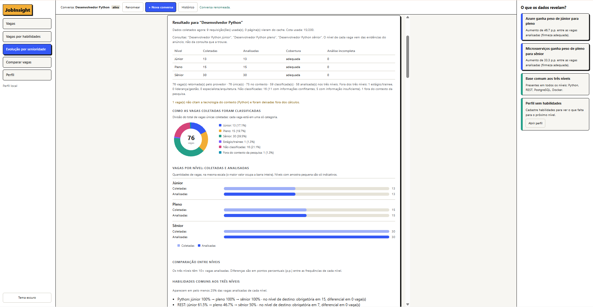
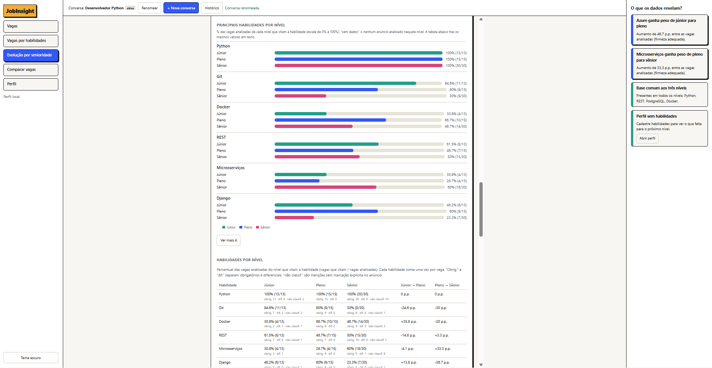
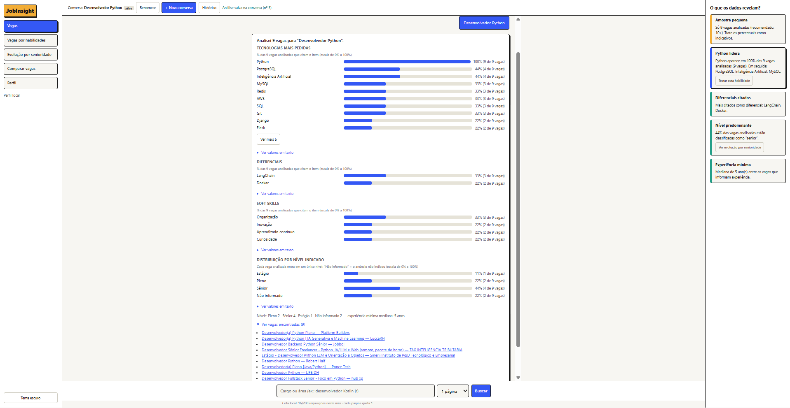
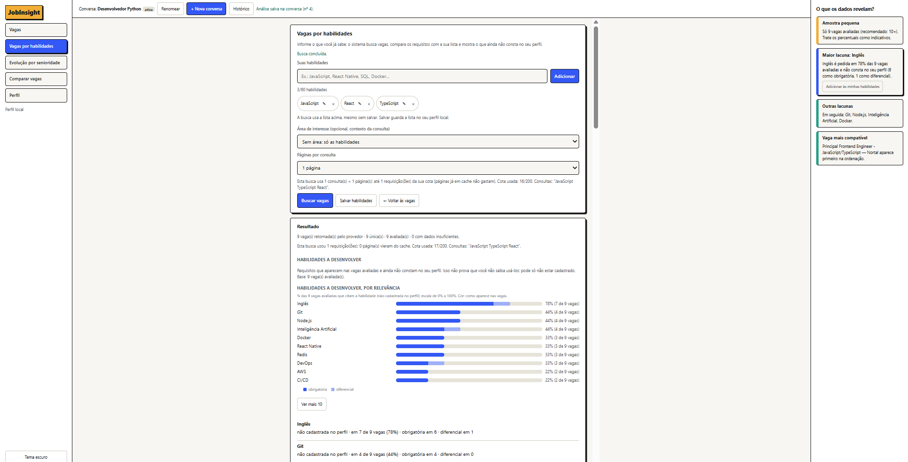
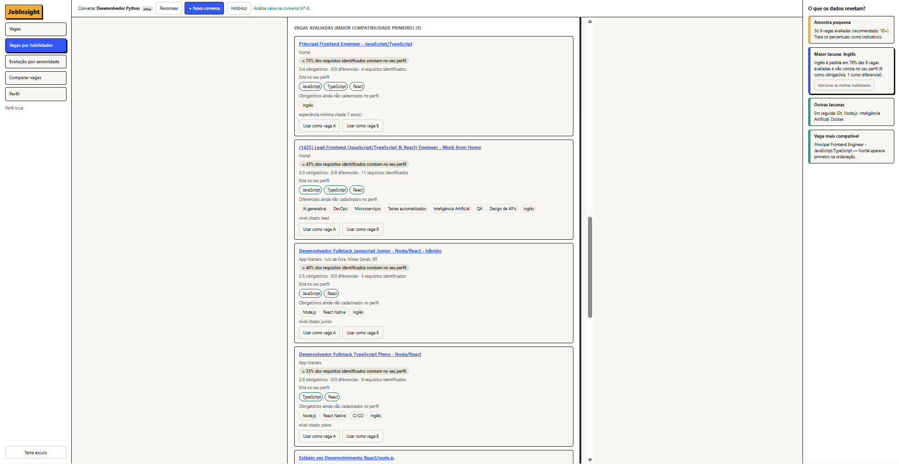
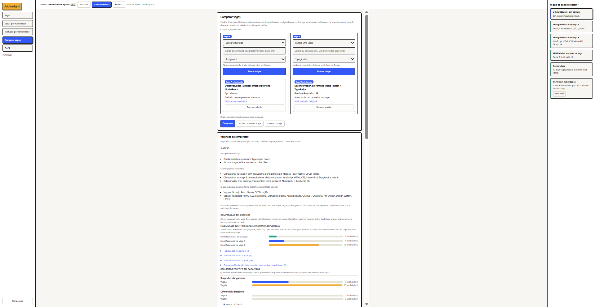

# JobInsight

Chatbot web que, a partir de um cargo ou área, busca vagas relacionadas e mostra os requisitos que mais aparecem nelas, com o percentual de vagas em que cada um é citado.

## Sobre o projeto

> Este projeto foi desenvolvido com vibecoding, utilizando IA como apoio durante o desenvolvimento. A principal proposta foi aprender na prática, especialmente sobre engenharia de prompt, refinamento de instruções e como transformar ideias em funcionalidades reais.

* Algumas funcionalidades inclusas:
  * #### Evolução por senioridade: coleta vagas de júnior, pleno e sênior, classifica cada uma e compara os requisitos entre os níveis.
  
  
  * #### Buscador de vagas: busca por cargo ou área, com ranking de tecnologias, diferenciais e soft skills, mostrando o percentual de vagas em que cada requisito aparece, além das respectivas vagas.
  
  * #### Analisador de vagas: realiza a busca reversa, mostrando quais habilidades você já tem e quais ainda precisa desenvolver para se adequar às vagas encontradas.
  
  
  * #### Comparador de vagas: compara duas vagas, mostrando os requisitos em comum e os que são exclusivos de cada uma.
  
Exemplo: ao buscar `desenvolvedor Kotlin jr`, você vê quais tecnologias, diferenciais e soft skills aparecem na maioria das vagas encontradas.

## Funcionalidades

- Busca de vagas por API (JSearch ou Adzuna)
- Ranking de tecnologias, diferenciais e soft skills, com nível e experiência mínima mediana
- Interface de chat no navegador, com botão de cancelar e cópia do resumo
- Cache local e contador de cota, para não gastar requisições à toa
- Extração gratuita por dicionário de palavras; uso opcional da Claude para uma extração mais precisa
- Tela **Perfil**: nome e áreas de conhecimento, salvos no SQLite local (base para personalizações futuras)

## Requisitos

- Python 3.10 ou superior
- Uma chave de API de vagas: [JSearch no OpenWeb Ninja](https://app.openwebninja.com) (tem plano gratuito) ou [Adzuna](https://developer.adzuna.com) (cadastro gratuito)

## Instalação

```bash
git clone https://github.com/Gabrielhanel/job-insight-chat.git
cd job-insight-chat
python3 -m venv .venv
source .venv/bin/activate        # Windows: .venv\Scripts\activate
python -m pip install -r requirements.txt
```

No Ubuntu/Debian, se o `venv` reclamar de `ensurepip`, instale antes o pacote: `sudo apt install python3-venv`.

## Configuração

Crie um arquivo `.env` na raiz do projeto (ao lado do `requirements.txt`). Configuração mínima com o JSearch:

```dotenv
PROVEDOR=jsearch
OPENWEBNINJA_API_KEY=sua_chave
```

Cada variável vai em uma linha, sem aspas e sem espaços em volta do `=`.

| Variável | Obrigatória | Descrição |
|---|---|---|
| `PROVEDOR` | Não | `jsearch` ou `adzuna`. Padrão: `adzuna` |
| `OPENWEBNINJA_API_KEY` | Com `jsearch` | Chave do JSearch no OpenWeb Ninja |
| `RAPIDAPI_KEY` | Alternativa | Chave do JSearch, se a assinatura for pela RapidAPI |
| `ADZUNA_APP_ID`, `ADZUNA_APP_KEY` | Com `adzuna` | Credenciais do Adzuna |
| `ANTHROPIC_API_KEY` | Não | Se definida, a extração usa a Claude em vez do dicionário |
| `EXTRACTION_MODEL` | Não | Modelo da Claude usado na extração. Padrão: `claude-haiku-4-5-20251001` |
| `QUOTA_MENSAL` | Não | Limite mensal do contador local. Padrão: `200` |
| `CACHE_TTL_H` | Não | Validade do cache das páginas, em horas. Padrão: `24` |
| `CACHE_DB` | Não | Caminho do arquivo SQLite do cache. Padrão: `cache.db` na raiz |

## Como rodar

```bash
source .venv/bin/activate
python -m uvicorn app.main:app --reload
```

Abra **http://localhost:8000** e digite um cargo. Rode sempre a partir da pasta do projeto. O servidor só lê o `.env` ao iniciar: depois de editá-lo, pare com `Ctrl+C` e rode de novo.

## Uso da API

A documentação interativa fica em **http://localhost:8000/docs**.

| Rota | Descrição |
|---|---|
| `GET /` | Interface de chat |
| `POST /chat` | Analisa um cargo. Corpo: `{"mensagem": "qa automation", "pais": "br", "paginas": 2, "apenas_novas": false}`. Com `apenas_novas: true`, continua nas páginas seguintes e devolve só vagas ainda não exibidas para a consulta |
| `GET /analisar?cargo=...&pais=br&paginas=2` | Mesma análise, via query string |
| `GET /status` | Uso da cota local e método de extração ativo |
| `GET /perfil` | Perfil salvo: `{existe, nome, areas, atualizado_em, limites}`. Sem perfil, devolve nome e áreas vazios |
| `PUT /perfil` | Substitui o perfil. Corpo: `{"nome": "Ana", "areas": ["Ciência de Dados", "Mobile"]}`. Para adicionar/remover áreas, envie a lista nova. Valida no servidor (422 com mensagem em texto): nome até 100 caracteres, áreas até 60 caracteres cada, no máximo 30, sem áreas vazias nem repetidas (sem diferenciar maiúsculas/minúsculas) |
| `GET /habilidades` · `PUT /habilidades` | Lista de habilidades do perfil, separada das áreas. `PUT` substitui só a lista (`{"habilidades": ["js", "React Native"]}`) e devolve os nomes canônicos (`JavaScript`). Duplicatas, inclusive por alias (JS e JavaScript), dão 422 |
| `POST /habilidades/normalizar` | `{"termo": "nodejs"}` → `{"nome": "Node.js", "chave": "node.js"}`. É a única regra de canonicalização usada pela interface |
| `POST /busca-habilidades/plano` | Mostra as consultas e o máximo de requisições, sem chamar o provedor |
| `POST /busca-habilidades` | Busca reversa. Corpo: `{"habilidades": [...] (omitido = as salvas), "area": "..." (opcional), "paginas": 1-5}`. Devolve vagas com compatibilidade, lacunas priorizadas e contagens |
| `POST /evolucao/plano` | Mostra as 3 consultas (uma por nível) e o máximo de requisições, sem chamar o provedor |
| `POST /evolucao` | Análise por senioridade. Corpo: `{"cargo": "Desenvolvedor React Native", "paginas": 1-3 (por nível), "habilidades": [...] (opcional; omitido = as salvas no perfil)}`. Devolve cobertura por nível, tabela de habilidades com % e diferenças em p.p., categorias comparativas, experiência, responsabilidades, requisitos do próximo nível ausentes do perfil e a classificação (com motivo) de cada vaga |
| `POST /comparar/plano` · `POST /comparar/buscar` | Seletores da tela "Comparar vagas": consumo previsto e lista de vagas de uma consulta (`{"consulta": "...", "paginas": 1-3}`), usando o cache e a cota existentes. Devolve `ref` (consulta, país, páginas) e, por vaga, id, título, empresa, local, link, publicação e se há descrição (sem o texto) |
| `POST /comparar` | Compara duas vagas. Cada lado é `{"tipo": "busca", "consulta", "pais", "paginas", "id"}` (a vaga é recarregada pelo cache) ou `{"tipo": "manual", "titulo", "empresa?", "link?", "descricao"}`. Devolve a análise de cada vaga (com trechos-evidência), a comparação consolidada e a síntese; `estado` = `completa` ou `parcial` |
| `POST /sessoes` · `GET /sessoes` | Cria uma conversa (`{"titulo"?}`, 201) · lista leve, da atividade mais recente para a mais antiga (sem resultados nem descrições) |
| `GET /sessoes/{id}` · `PATCH` · `DELETE` | Abre a conversa com todas as análises e resultados salvos (nenhuma chamada externa, nenhuma cota) · renomeia (`{"titulo"}`) · exclui só a conversa e suas análises |
| `POST /sessoes/importar-legado` | Converte, uma vez, o histórico antigo do navegador (busca por cargo) em uma conversa |
| `sessao_id` / `interacao_uid` | Campos opcionais de `/chat`, `/busca-habilidades`, `/evolucao` e `/comparar`: com `sessao_id` o servidor grava o resultado que ele mesmo calculou; o mesmo `interacao_uid` repetido devolve o registro salvo sem recalcular e sem gastar cota. A resposta ganha `interacao` e `salvo` (se a gravação falhar, a análise volta com `salvo: false` e `aviso_historico`) |

```bash
curl -X POST http://localhost:8000/chat \
  -H "Content-Type: application/json" \
  -d '{"mensagem": "desenvolvedor Kotlin jr", "pais": "br", "paginas": 2}'
```

A resposta traz `resposta` (texto pronto) e `dados` (o mesmo resultado em JSON).

## Páginas e cota

- `paginas` aceita de 1 a 5. Sem o campo, o padrão é 3 no JSearch (~10 vagas por página) e 1 no Adzuna (até 50 vagas por página).
- Cada página gasta 1 requisição da cota do provedor. O plano gratuito do JSearch no OpenWeb Ninja mostrava 200 requisições por mês no painel; confira os limites atuais na sua conta.
- Páginas já buscadas ficam em cache por 24 horas e não gastam cota de novo.
- O contador local (`x/200` na interface) só conta as requisições feitas por este projeto. Compare com o painel do provedor.

## Perfil

Clique em **Perfil** no topo da página, informe o nome (opcional), adicione áreas de conhecimento (botão **Adicionar** ou Enter; o × remove) e clique em **Salvar**. Os dados ficam nas tabelas `perfil` e `perfil_areas` do mesmo SQLite (`cache.db`); elas são criadas automaticamente, sem tocar nas tabelas existentes. O perfil não é enviado a nenhum serviço externo.

## Testes

```bash
python -m pip install -r requirements-dev.txt
python -m pytest tests -q          # API, persistência (inclui reinício real do servidor), normalização, compatibilidade, senioridade e buscas (provedor simulado)

cd tests/ui && npm install && npm test   # interface (jsdom + servidor real); requer Node 18+
```

Os testes usam SQLite temporário e não precisam de chaves de API.

## Vagas por habilidades (busca reversa)

Aba **Vagas por habilidades**: você informa o que sabe (a lista da tela é usada mesmo sem salvar), e o sistema busca vagas, compara os requisitos e mostra o que ainda não consta no seu perfil.

**Consultas.** O `query` do JSearch é texto livre, sem operadores booleanos, então a busca monta no máximo **2 consultas determinísticas** com até 3 habilidades cada (2 no Adzuna). A seleção usa a ordem do dicionário, não a ordem digitada; as habilidades que não cabem ficam fora do texto da consulta, mas contam na compatibilidade. Só vão ao provedor o texto da consulta (habilidades + uma área opcional), a página e o país: nome e demais dados do perfil não saem do computador. Consumo máximo = consultas × páginas; páginas em cache e a cota mensal seguem as regras da busca por cargo. "Carregar mais" pede uma página a mais por consulta (as anteriores vêm do cache), até 5. Essa busca não usa nem altera o histórico/progresso da busca por cargo.

**Normalização** (`app/skills.py`, única fonte): ignora caixa, acentos e espaços; preserva `+ # . /` (C, C++ e C# são distintos; `.NET` ≠ `ASP.NET`); aliases vêm de `keywords.py`/`aggregate.py` + poucos extras. Sem correspondência por prefixo ou aproximada.

**Compatibilidade estimada** (`app/compat.py`) = `100 × (2·OC + DC) / (2·OT + DT)`, com OT/DT = obrigatórios/diferenciais identificados e OC/DC = os que constam no seu perfil; cada requisito conta uma vez. Sem requisitos identificados não há nota ("dados insuficientes"). É a cobertura dos requisitos que o extrator identificou, não uma chance de contratação: ignora senioridade, experiência e formação. "Obrigatório" é o que aparece fora da seção de diferenciais/desejáveis do anúncio (heurística). Vagas com menos de 3 requisitos ou descrição curta recebem nota marcada como de pouca base e ficam abaixo das demais.

**Habilidades a desenvolver**: requisitos ausentes do perfil, ordenados por nº de vagas em que aparecem, depois como obrigatórios, depois como diferenciais, depois nome. "Não cadastrada no perfil" não significa desconhecimento.

## Evolução por senioridade

Aba **Evolução por senioridade**: informe um cargo/área e o sistema coleta vagas dos três níveis com o mesmo contexto, classifica cada vaga pelas evidências do anúncio e compara os requisitos entre júnior, pleno e sênior. Descreve anúncios coletados, não trajetórias reais de carreira.

**Coleta.** 1 consulta por nível (`<cargo> júnior|pleno|sênior`; `junior|mid-level|senior` fora do Brasil; "associate" não é usado) pelo mesmo `jobs.buscar_vagas`, com a mesma cota e cache (válido por até 24 h) das outras buscas: no máximo `3 × páginas` requisições (páginas ≤ 3). O termo na consulta só orienta o provedor (texto livre, sem filtro de senioridade): o nível final vem da vaga. Se a cota acabar, o que já foi coletado é preservado e o aviso aparece. Quando o cargo tem tecnologia reconhecida (ex.: React Native), vagas que não a citam ficam fora dos cálculos (e são contadas); sem tecnologia reconhecida, a tela avisa que não dá para garantir a mesma área.

**Classificação** (`app/senioridade.py`, sem IA): título com um nível explícito vale se a descrição não o contradiz (frase de outro nível ou anos mínimos fora da faixa); título com dois níveis ou contradição = não classificada (conflitante); sem nível no título, vale uma frase explícita na descrição ("vaga de nível pleno") ou, no mínimo, 3 indícios (anos mínimos, mentoria, arquitetura, decisões técnicas...) com folga de 2 sobre o 2º colocado. Nunca se usa o número de tecnologias nem o tamanho do texto. Estágio/trainee, liderança/gestão e especialista/arquitetura ficam fora dos três níveis. A "confiança" (alta/média) vem da regra aplicada; não é probabilidade. Cada vaga guarda o motivo.

**Estatísticas** (`app/comparativo.py`): denominador = vagas do nível com requisitos analisados (não as coletadas); cada habilidade conta uma vez por vaga; % de menção, de obrigatória e de diferencial. Sem marcador explícito no anúncio (requisitos/obrigatório/diferencial/desejável), as tecnologias ficam "não classificadas" em vez de obrigatórias. Diferenças entre níveis em **pontos percentuais**. Limiares (no topo do módulo): amostra adequada ≥ 10 vagas analisadas por nível; 3–9 = baixa (resultado indicativo); < 3 = comparação não calculada; destaque de diferença ≥ 15 p.p. e ≥ 20% no lado maior; comum ≥ 25% nos três níveis. Experiência e responsabilidades só usam vagas de nível explícito (evita circularidade) e a mediana só aparece com 5+ valores.

**Perfil.** Com habilidades cadastradas, lista os requisitos presentes em 20%+ das vagas do nível de destino que "não constam no perfil". Sem perfil, a análise funciona igual.

## Comparar vagas

Aba **Comparar vagas**: escolha a vaga A e a vaga B (cada lado tem a própria busca, então podem ser de cargos, níveis ou áreas diferentes; ou digite a descrição manualmente) e compare. Em "Vagas por habilidades" cada cartão tem "Usar como vaga A/B".

**Como as vagas chegam.** Uma seleção guarda `{consulta, país, páginas, id}`; a comparação recarrega a vaga pelo mesmo `jobs.buscar_vagas` (cache de páginas, 24 h, e cota existentes), uma leitura por consulta. Vaga vista há pouco não gera requisição nova; se o cache expirou, a página é buscada de novo (e contada). O Adzuna não tem cache de páginas no projeto, então cada recarga chama o provedor (comportamento anterior). A identidade é o id do provedor (ou título+empresa+local); duas vagas com o mesmo título continuam distintas e a mesma vaga nos dois lados é recusada. Nada é gravado no banco.

**Entrada manual.** Título (até 200), empresa (120), descrição (até 8000 caracteres) e link opcional. É marcada como "inserida manualmente, não verificada". O link só é validado (http/https) e exibido: o backend nunca o acessa (sem scraping). Se `ANTHROPIC_API_KEY` estiver configurada, o texto da descrição (de qualquer origem) segue para a extração por IA, como na busca atual; o perfil e dados pessoais nunca são enviados.

**Regras.** Habilidades equivalentes = mesma chave canônica de `skills.py` (JS = JavaScript; Java ≠ JavaScript, React ≠ React Native, C ≠ C++ ≠ C#, SQL ≠ PostgreSQL, .NET ≠ ASP.NET). "Relacionadas, mas distintas" vêm de um mapa curado pequeno (`skills.RELACOES`), só como observação, nunca como comuns. Cada habilidade, responsabilidade, formação e certificação traz o trecho original que a sustenta (ou "trecho não localizado"). **Dado ausente ≠ requisito ausente:** "identificada só na vaga A" só é afirmada sem ressalva quando a análise da vaga B está sem limitações (descrição curta, trecho parcial do provedor, IA falhou, truncada, sem tecnologias); caso contrário aparece o aviso de que pode ser omissão. Requisitos sem marcador de obrigatório/desejável ficam "classificação desconhecida", nunca "opcional".

**Compatibilidade.** É a de `app/compat.py` (fórmula da Etapa 2, sem alterações), calculada com as habilidades do perfil, por vaga; sem perfil, dados insuficientes ou falha, não há nota. É cobertura dos requisitos identificados, não chance de contratação, e não elege vaga "melhor".

## Gráficos

Os gráficos são CSS/SVG nativos, sem biblioteca, CDN nem `<canvas>` (tudo no `index.html`, funções `graficoBarras`, `graficoAgrupado` e `graficoRosca`). Eles só desenham números que o backend já devolve; nenhum percentual é recalculado no navegador, e cada gráfico repete seus valores em texto (lista "Ver valores em texto", tabela ou lista ao lado).

| Onde | Gráfico | Dados |
|---|---|---|
| Busca por cargo | Barras: tecnologias, diferenciais e soft skills (10/5/8 iniciais, "Ver mais"), % das vagas analisadas que citam o item (escala fixa 0–100%) | `dados.tecnologias`, `diferenciais`, `soft_skills` |
| Busca por cargo | Barras: distribuição por nível indicado (omitido, com aviso, se nenhuma vaga indicou nível) | `dados.niveis_detalhe` (novo, aditivo) |
| Vagas por habilidades | Barras de "habilidades a desenvolver", segmentadas em obrigatória/diferencial | `lacunas.itens` |
| Evolução por senioridade | Rosca: como as vagas coletadas foram classificadas (partes que somam o total) | `distribuicao` (novo, aditivo) |
| Evolução por senioridade | Barras agrupadas: vagas coletadas × analisadas por nível; principais habilidades por nível (júnior/pleno/sênior) | `niveis`, `habilidades` |

Rosca só é usada para partes de um mesmo total; rankings e percentuais que se sobrepõem usam barras. Níveis sem vagas aparecem como "sem dados" (nunca barras inventadas); gráficos sem dados são omitidos. Resultados antigos guardados no navegador, sem os campos novos, mostram só o que já existia.

### Comparar vagas: seleção, identificadores e gráficos

**Seleção a partir de "Vagas por habilidades".** Cada cartão tem "Usar como vaga A/B". O botão passa a "Selecionada como vaga A/B" (`aria-pressed`), aparece a barra "Vagas para comparar" (com "Remover" por vaga e "Abrir Comparar vagas") e a seleção vale na tela Comparar vagas. A seleção guarda a referência completa `{consulta, país, páginas, ID original, provedor}` (não a lista atual nem a descrição), então continua válida depois de outra pesquisa; ela fica em memória e se perde ao recarregar a página. A identidade é provedor + ID (nunca o título); a mesma vaga em A e B é barrada; "Comparar" só habilita com as duas seleções válidas para o contrato de `/comparar`.

**Identificadores e limites.** O ID do provedor é opaco: segue sem corte, recodificação ou `strip` do provedor até a requisição. Limites da seleção (em `app/comparador.py`; o frontend os espelha e um teste confere): ID até **1024** caracteres (IDs estilo Google Jobs em base64 passam de 300), consulta de origem até **184** (área + 3 habilidades, derivado de `reversa.MAX_AREA` e `perfil.MAX_HABILIDADE`) e até **5** páginas (`reversa.MAX_PAGINAS`). A busca digitada na tela Comparar vagas continua com consulta de até 80 caracteres e 3 páginas. O defeito original era a seleção vinda de "Vagas por habilidades" ser recusada com 422 (consulta de mais de 80 caracteres, mais de 3 páginas ou ID de mais de 300 caracteres).

**Gráficos da comparação** (reaproveitam os helpers da Etapa 5; cores fixas: vaga A azul, vaga B laranja, em comum verde): barras de habilidades em comum e específicas (escala do total; listas completas em "Ver valores"), barras agrupadas de obrigatórios × diferenciais (com grupo à parte para "sem classificação"), barras de compatibilidade (só com nota válida, usando `compat.avaliar`; uma única nota vem com aviso, nenhuma nota some o gráfico) e barras de experiência mínima (só quando as duas vagas informam). Dados desconhecidos não viram zero. Pizza/rosca não é usada: as categorias são habilidades que coexistem.

## Conversas (histórico persistente)

A barra sob o cabeçalho mostra a conversa ativa, com **+ Nova conversa**, **Renomear** e **Histórico** (lista de conversas, ordenada pela atividade mais recente, e a linha do tempo da conversa ativa). Cada análise (busca por cargo, por habilidades, evolução por senioridade e comparação) é gravada na conversa ativa, que é criada sozinha na primeira análise (título = 1ª consulta, sem IA). Abrir uma conversa reexibe as análises salvas, com os gráficos reconstruídos dos dados salvos e a identificação "Resultado salvo… nada foi consultado de novo": nada é refeito nem gasta cota. As telas de habilidades, evolução e comparação mostram o resultado mais recente da conversa; os demais abrem pela linha do tempo ("Abrir").

**Modelo (SQLite, criado/atualizado automaticamente, sem tocar nas tabelas existentes):** `sessoes` (id aleatório independente do título, título, datas) e `interacoes` (sessão, `seq` cronológico, `uid` do evento, tipo, consulta, parâmetros, resultado em JSON, status, resumo), com chave estrangeira e exclusão em cascata. Excluir uma conversa não mexe em cache de páginas, cota, perfil nem histórico de vagas. O navegador guarda só o id da conversa ativa.

**Regras e limites:** um resultado por interação, exatamente o que a tela mostrou (inclusive dados dos gráficos); resultados acima de 1,5 MB não são guardados (a consulta fica registrada, com aviso); até 200 análises por conversa; valores de chaves de API presentes no ambiente nunca são gravados. Uma resposta que chega depois de trocar de conversa não entra na conversa nova (fica salva na de origem, com aviso). Cliques repetidos não duplicam registros, mas repetir uma consulta de propósito gera nova análise. O histórico antigo do `localStorage` (busca por cargo) é importado uma vez para a conversa "Conversas anteriores (importadas)"; a cópia original permanece no navegador. "Carregar mais" em habilidades e refazer uma busca geram novas análises salvas na conversa.
